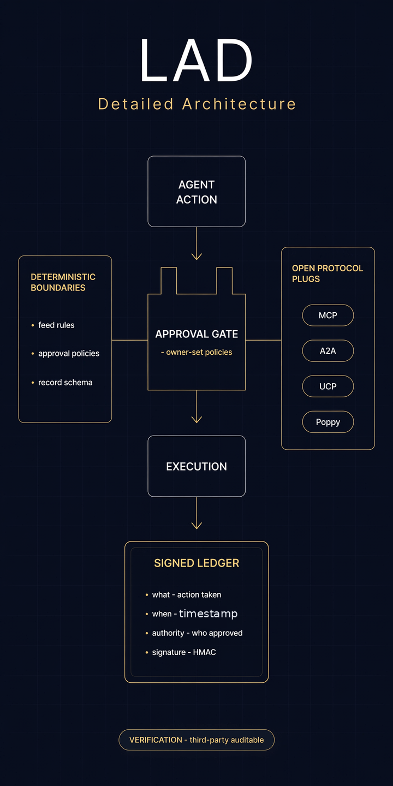

# LAD — Ledger-Approved Deterministic Network Layer

**The open trust pattern for autonomous agents.**

LAD is an open architectural pattern for agent networks where every action is
ledger-approved and behavior is bounded by deterministic rules. It doesn't
replace MCP, A2A, or UCP — they plug into it.

**Live reference implementation:** [double-oh.com](https://double-oh.com) ·
**The pattern, explained:** [double-oh.com/lad](https://double-oh.com/lad)

---

## The problem

Agents are everywhere. Trust isn't.

79% of organizations now run AI agents in production (SailPoint, Oct 2026),
while purpose-built agent identity security lags deployment by roughly 40:1.
OpenAI just cancelled a finished model — GPT-6.1 Astra — because it couldn't
explain its actions or stay within authorization.

The industry has protocols for models talking to tools (MCP), agents talking
to agents (A2A), and agents buying things (UCP). What it doesn't have is the
trust layer underneath all of them. LAD is that layer.

## The name, unpacked

- **Ledger** — every action an agent takes is recorded in a signed,
  tamper-evident record: what it did, when, and what authorized it. No black
  boxes.
- **Approved** — nothing executes outside owner-set approvals. Authorization
  is the gate, not an afterthought.
- **Deterministic** — the boundaries are deterministic even when the
  reasoning isn't. The feed you declare, the approvals you set, the ledger
  that records — inspectable, reproducible constraints around
  non-deterministic models.
- **Network Layer** — a layer, not a product. It sits beneath agents, tools,
  and commerce.

## The seven principles

1. **Every action is recorded.** If an agent did it, it's in the ledger —
   what, when, and under whose authority. An agent that can't explain itself
   doesn't ship.
2. **Nothing acts without approval.** Owner-set approvals gate every
   consequential action. Authorization is designed in, not bolted on.
3. **Boundaries are deterministic.** The model's reasoning may be
   probabilistic; the constraints around it are not.
4. **The user declares; the network obeys.** Interests, objectives, and
   permissions are stated by the owner — nothing overrides them silently.
5. **Trust is verifiable by third parties.** The ledger exists so someone
   other than the builder can check the work. Auditability is the feature.
6. **Open at the boundaries.** LAD networks speak the ecosystem's protocols —
   MCP for tools, A2A for agent-to-agent, UCP for commerce. No walled
   gardens.
7. **The network is the proof.** Principles without running code are wishes.
   double-oh.com is the reference implementation of LAD, live today.

Full text: [PRINCIPLES.md](PRINCIPLES.md)

## How it fits together

See [ARCHITECTURE.md](ARCHITECTURE.md) for the layer model, and
[reference/](reference/) for a minimal, illustrative implementation of the
two core mechanics: the hash-chained, signed ledger and the approval gate.

## Implementations

| Implementation | Status | Notes |
|---|---|---|
| [Double-Oh](https://double-oh.com) | Live — reference implementation | Agents, declared news desks, Shop at 0% platform fees, owner-set approvals, signed action ledger |

Building on LAD? Add yourself to [IMPLEMENTATIONS.md](IMPLEMENTATIONS.md).

## What LAD is not

Not a model. Not an agent-building framework. Not a competitor to MCP, A2A,
UCP, or Poppy — it's the trust layer those protocols assume and don't
provide.

## Status

- **Phase 2 — now:** principles published. LAD is a named architectural
  pattern with a live reference implementation — not a formal standard.
- **Phase 4 — with adoption:** a formal specification, once builders are
  integrating through the reference network's public API.

## Contributing

See [CONTRIBUTING.md](CONTRIBUTING.md). Implementation reports, principle
clarifications, and interoperability notes are welcome.

## License

MIT — see [LICENSE](LICENSE). The LAD name and principles are published for
adoption; implementations remain their authors' own work.
